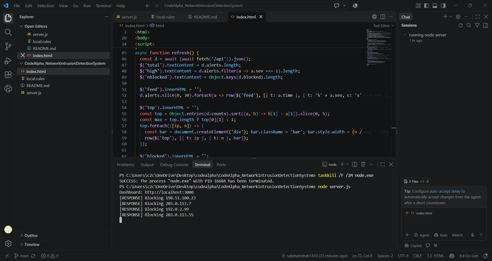
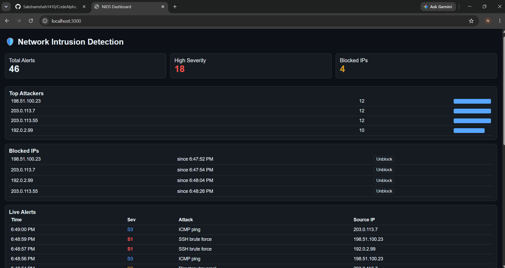
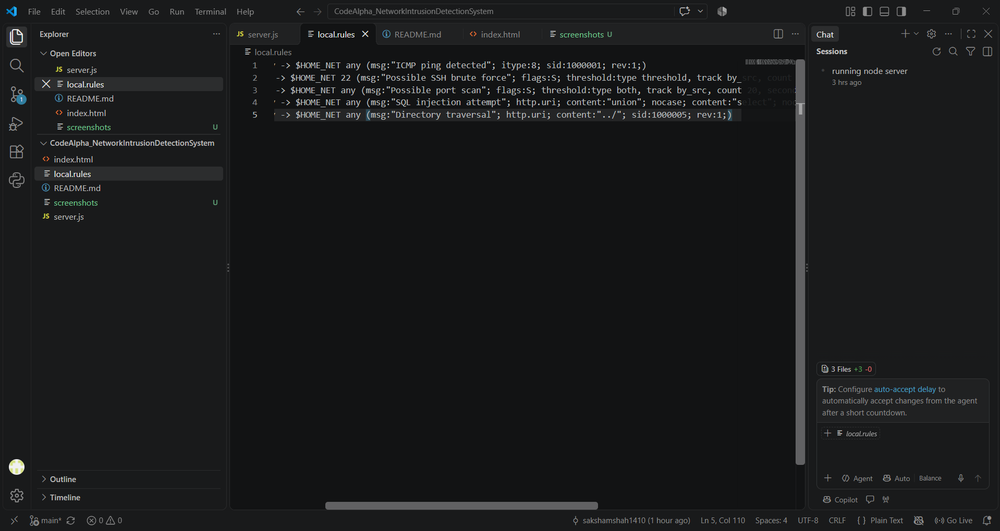
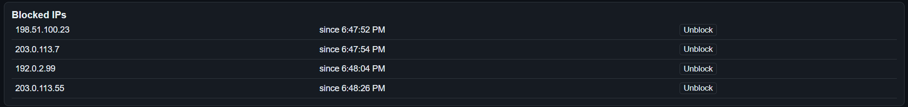

# Network Intrusion Detection System (NIDS)

A lightweight network intrusion detection system built with **Suricata rules**, a **Node.js** monitoring server, and a live **HTML/CSS/JavaScript** dashboard. Task 3 of the **CodeAlpha Cybersecurity Internship**.

## Features

- **Detection rules:** Suricata rules for ICMP ping, SSH brute force, port scan, SQL injection, and directory traversal.
- **Continuous monitoring:** the server reads Suricata's `eve.json` alert log in real time.
- **Automated response:** an IP is blocked automatically on a high-severity alert, or after 5 or more alerts from the same IP. Blocked IPs can be unblocked from the dashboard.
- **Live dashboard:** summary cards, top attackers chart, blocked IP list, and a live alert feed.
- **Demo mode:** if Suricata is not installed, the server generates simulated attacks so the full system can be demonstrated.

## Architecture

```
Network traffic -> Suricata (rules) -> eve.json -> Node.js server -> Dashboard (browser)
                                                        |
                                                  Response engine
                                                  (block / unblock)
```

## Project Structure

```
CodeAlpha_NetworkIntrusionDetectionSystem/
├── server.js        # Alert reader, response engine, web server
├── index.html       # Dashboard (HTML + CSS + JS)
├── local.rules      # Custom Suricata detection rules
└── README.md
```

## Detection Rules

| SID | Attack | What it detects |
|-----|--------|-----------------|
| 1000001 | ICMP ping | Incoming ICMP echo requests |
| 1000002 | SSH brute force | 5+ SYN packets to port 22 from one source in 60 seconds |
| 1000003 | Port scan | 20+ SYN packets from one source in 10 seconds |
| 1000004 | SQL injection | HTTP URI containing `union` and `select` |
| 1000005 | Directory traversal | HTTP URI containing `../` |

## Response Mechanism

| Condition | Action |
|-----------|--------|
| Alert severity = 1 (high) | Source IP is blocked immediately |
| 5 or more alerts from the same IP | Source IP is blocked |
| Analyst clicks **Unblock** | IP is removed from the blocked list |

Blocking is logged in the server console. On a Linux host it can be enforced with the firewall command
`iptables -I INPUT -s <ip> -j DROP`.

## How to Run

### Requirements
- Node.js (LTS) from https://nodejs.org
- VS Code (optional)

### Demo mode (Windows / Linux / macOS)
```
node server.js
```
Open **http://localhost:3000** in your browser.

### Real mode with Suricata (Linux / WSL)
```
sudo apt install suricata
sudo cp local.rules /var/lib/suricata/rules/
sudo suricata -c /etc/suricata/suricata.yaml -i eth0
sudo node server.js
```
Add `local.rules` under `rule-files:` in `suricata.yaml`. The server switches to real mode automatically when
`/var/log/suricata/eve.json` exists. A different path can be set with the `EVE_PATH` environment variable.

## Testing (on your own network only)

- Port scan: `nmap -sS <target-ip>`
- ICMP: `ping <target-ip>`

## Technologies

Suricata, Node.js, HTML, CSS, JavaScript

## Limitations and Future Work

- Demo mode uses simulated data, not live packet capture.
- Add real firewall enforcement and whitelisting of trusted IPs.
- Add alert history in a database and email/Slack notifications.
- Add GeoIP lookup for attacker locations.

## Disclaimer

This project is for educational purposes. Run attack tests only on networks you own or have permission to test.

##screenshots








